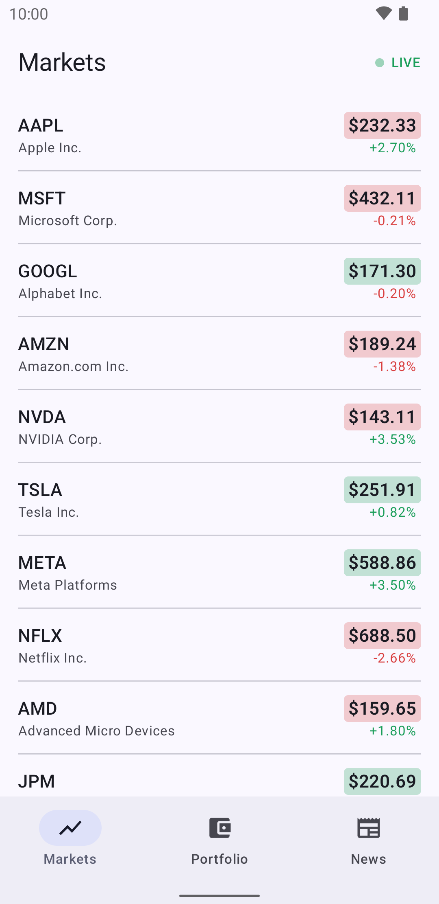
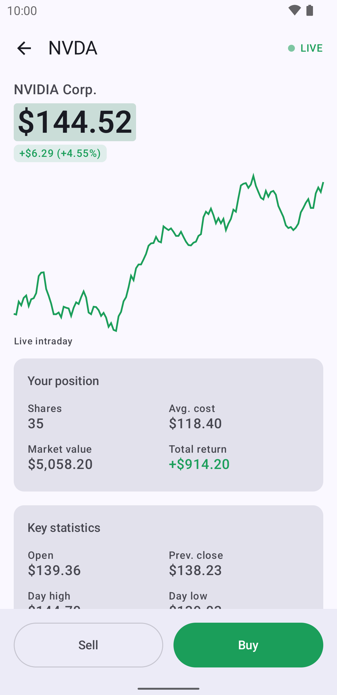
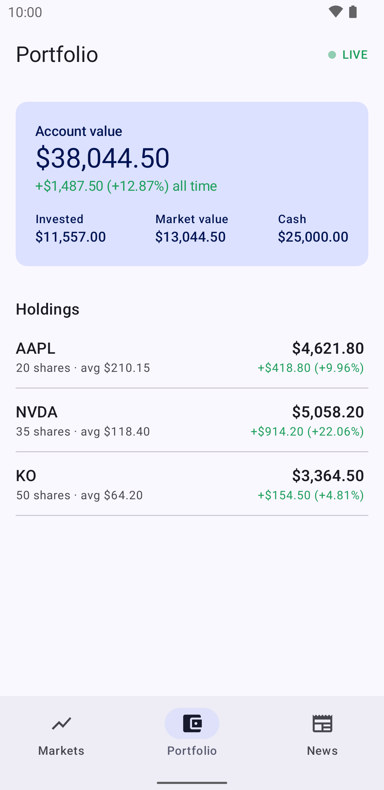
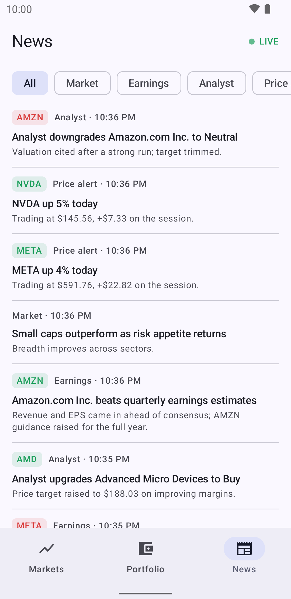
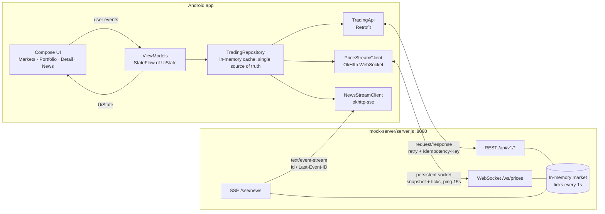
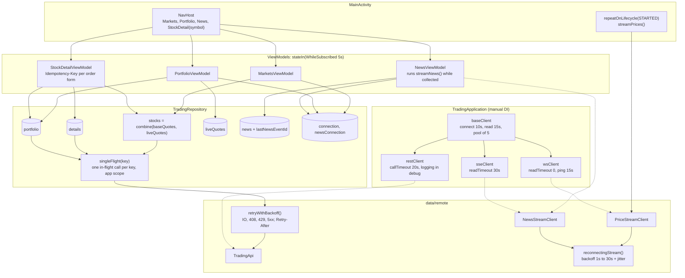
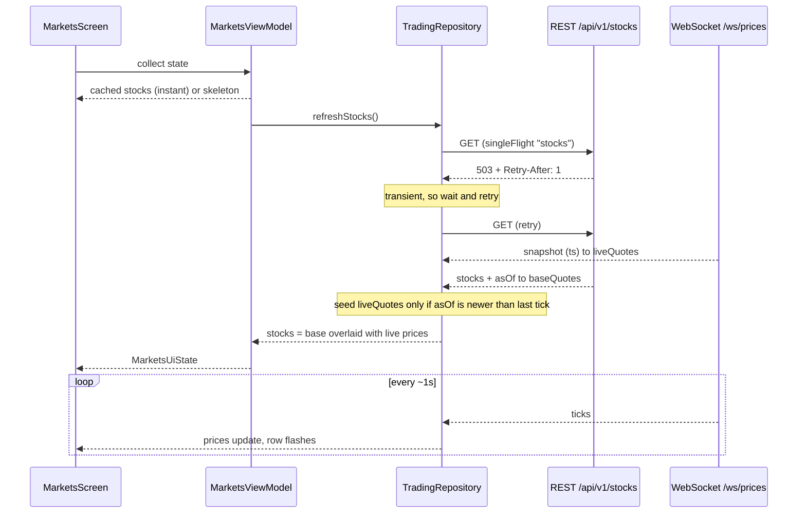
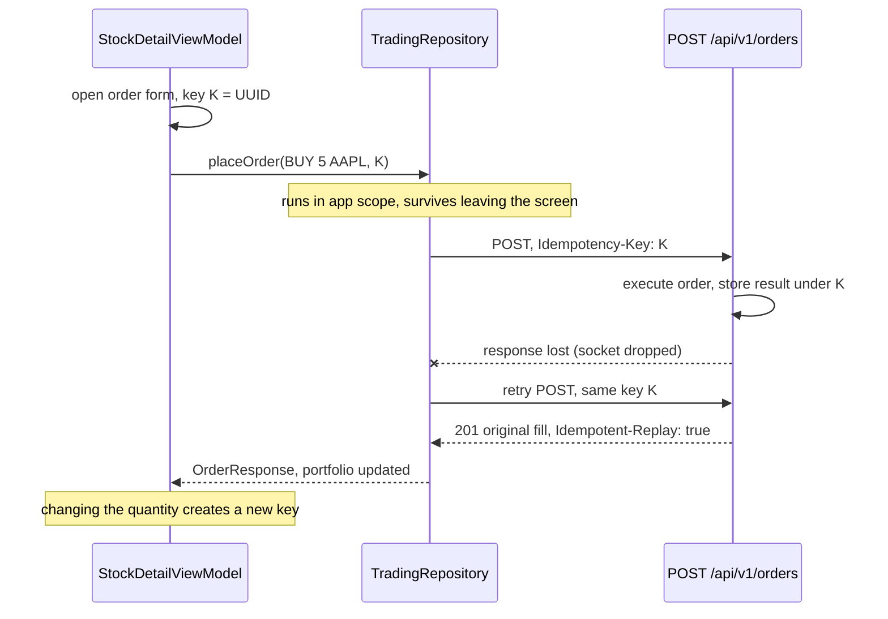
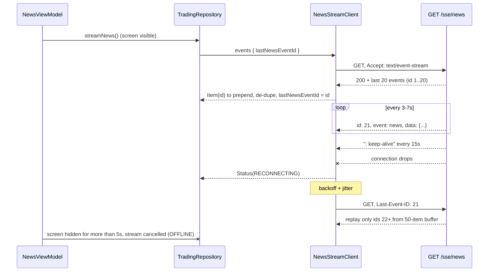
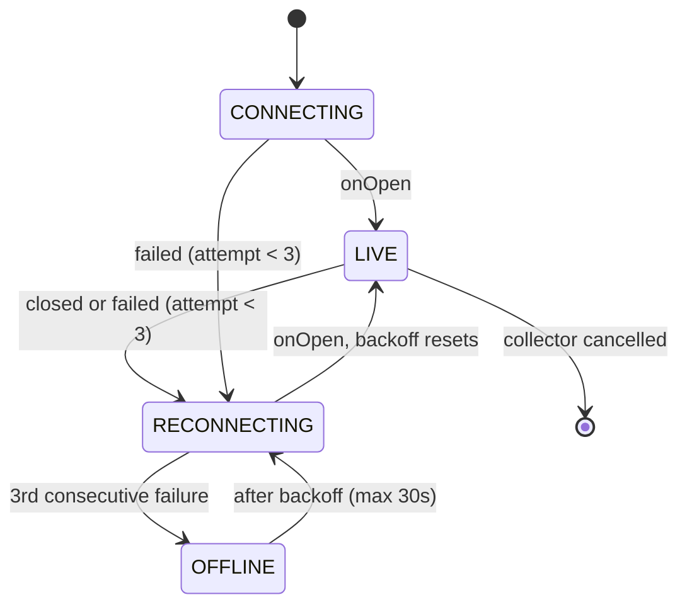

# Sample Trading App

Jetpack Compose trading app backed by a local mock server that simulates a slow, flaky network.
It demonstrates the three common transport styles side by side:

| Data | Transport | Why (in one line) |
|---|---|---|
| Stock list, details, portfolio, orders | REST (Retrofit + kotlinx.serialization) | The client asks, the server answers once. Needs status codes and safe retries |
| Live prices | WebSocket (`/ws/prices`) | Many updates per second over one long-lived connection. Only the latest value matters |
| Market news feed | Server-Sent Events (`/sse/news`) | Infrequent one-way events. Missing one matters, so it must resume without gaps |

See [Choosing a transport](#choosing-a-transport) for the full reasoning.

## Quick start

```bash
node mock-server/server.js          # Node 18+, no dependencies; listens on :8080
./gradlew :app:installDebug         # emulator reaches the host at 10.0.2.2
```

On a physical device, run `adb reverse tcp:8080 tcp:8080` and use the `benchmark` build type, or
point the URLs in `app/build.gradle.kts` at your machine's LAN IP.

## Screens

- **Markets**: all stocks with live prices that flash on each tick. Pull to refresh.
- **Portfolio**: cash, holdings and P&L, revalued live from the price stream.
- **Stock detail**: stats, price chart and buy/sell orders.
- **News**: live SSE feed of market news, earnings, analyst ratings and price alerts. Filter by
  category; tap a ticker to open its detail screen.

Each tab shows a connection pill (Live / Connecting / Reconnecting / Offline).

## Screenshots

| Markets | Stock detail | Portfolio | News (SSE) |
|---|---|---|---|
|  |  |  |  |

To regenerate, unlock a connected device and run `ANDROID_SERIAL=<serial> docs/capture-screenshots.sh`.

## Choosing a transport

The choice follows two questions about the data:

1. **Who starts the exchange?** If the user does it (open a screen, place an order), use
   request/response. If the server knows first (a price moved, news broke), use push.
2. **What does a reconnecting client need?** For prices, only the latest value matters; a fresh
   snapshot replaces any missed updates. For news, every event matters, so missed events must be
   replayed.

The app targets a slow, unreliable network: the mock adds 1.5–2.5s to every response and push,
and fails up to 10% of requests. That makes these choices more important.

### REST: stock list, details, portfolio, orders

- **The user starts these exchanges and expects one answer**: "show me AAPL", "buy 5 shares".
  Plain HTTP request/response already provides what this needs: status codes, timeouts and
  `Retry-After`.
- **Retries follow HTTP semantics.** GETs are safe to retry, so `Retry.kt` retries I/O errors,
  408, 429 and 5xx with backoff and never retries other 4xx errors. Orders are POSTs, which are
  not safe to repeat by default. The `Idempotency-Key` header makes them safe: if the response is
  lost (the mock does this on purpose), the retry returns the original fill instead of buying
  twice.
- **Orders are deliberately not sent over the WebSocket.** A message written to a socket that
  then drops has no acknowledgement. The client can't tell whether the order executed. Fixing
  that means rebuilding request IDs, acknowledgements, timeouts and replay on top of the socket,
  which HTTP plus an idempotency key already provides.
- **Each response stands alone**, so it can be cached, de-duplicated (identical in-flight calls
  share one request) and tested with `curl`. Scaling the backend needs no sticky sessions.
- **The data is fetched once, then kept live by push.** The list, detail and portfolio data
  arrives over REST once per screen. After that, the WebSocket overlays live prices, so slow REST
  calls are not repeated on every tick.

### WebSocket: live prices

- **Updates are frequent and the server knows first.** Every stock ticks every second.
  - **Why not polling:** the client would always be up to one polling interval behind. Each poll
    would also pay the full round trip plus HTTP headers. With the mock's ~2s delay, a 1s poll
    would keep several requests in flight, and each answer would already be stale on arrival.
  - **What push gives instead:** the server sends as soon as it has data, and there is no request
    leg for each update.
- **One persistent connection, low overhead per message.** After the HTTP upgrade, a message
  costs a frame header of a few bytes instead of a full set of HTTP headers. The TCP/TLS handshake
  happens once, not for every update.
- **Built-in liveness check.** OkHttp sends a WebSocket ping every 15s (`pingInterval`). If no
  pong arrives, the socket fails and `Reconnect.kt` reconnects with backoff. The stream has no read
  timeout because silence is normal between ticks.
- **No gap replay is needed.** Prices are state ("latest value wins"), not an event log. The
  server sends a full `snapshot` on every connect, and the client replaces its map. Missed
  ticks during an outage are simply out of date.
- **Room to grow both ways.** Today the server pushes every symbol and ignores client messages.
  In a real app the same socket would carry `subscribe` / `unsubscribe` messages for the visible
  rows, and could switch to binary (e.g. protobuf) frames. SSE can do neither, because it is
  server-to-client only and text-only.
- **Lifecycle:** the socket is open only while the app is visible (`repeatOnLifecycle(STARTED)`
  in `MainActivity`). This saves battery and data. The cached prices show instantly when the app
  returns, and the snapshot then corrects them.

### Server-Sent Events: market news

- **News flows one way and arrives a few times a minute.** A WebSocket's two-way channel and
  binary frames would go unused. SSE is a plain long-lived HTTP GET (`text/event-stream`), so
  proxies, load balancers, auth headers and HTTP logging handle it like any other request, with no
  protocol upgrade.
- **Missing a headline is a real loss.** Unlike prices, a missed news item isn't replaced by the
  next one. SSE has resume built into the protocol:
  - Every event carries an `id:`.
  - A reconnecting client sends `Last-Event-ID`.
  - The server replays only the events after that id, from a 50-item buffer.

  Doing this over a WebSocket would mean designing a custom sequence-number and replay protocol.
- **Dead-link detection is simple.** The server sends a `: keep-alive` comment every 15s. The
  SSE client's 30s read timeout turns silence into a reconnect.
- **The client never drops an event**, because the next `Last-Event-ID` would tell the server it
  was received, and it would be lost for good.

### Alternatives considered

| Option | Why not here |
|---|---|
| Polling REST for prices | Always behind by up to one interval, pays full latency and headers on every poll, and wastes battery/data when nothing changed |
| SSE for prices too | Would work for one-way push, but leaves no channel for per-screen subscriptions and can't carry binary payloads |
| WebSocket for everything | Orders would lose HTTP status codes and idempotency semantics; news would need a hand-built replay protocol |
| gRPC streaming | Good production option (HTTP/2, protobuf, typed contracts), but needs a protobuf toolchain and a gRPC server. Too heavy for a prototype mock |
| Firebase Cloud Messaging | For alerts while the app is in the background, not for in-app real-time data: delivery is best-effort, delayed and rate-limited |

### Known trade-offs in this prototype

- Each price tick sends every symbol, not just the changes. That's fine for 12 stocks but wasteful
  for 300+ (the performance tests' `liveUpdatesIdle` measures the decode cost). The fix is deltas
  plus subscriptions over the same socket.
- Two persistent connections (WebSocket + SSE) cost more battery than one multiplexed channel.
  A production app might carry news over the price socket as a second message type. It would then
  need its own sequence numbers for replay, because the socket has no `Last-Event-ID`.
- Everything is cleartext HTTP/WS against a local mock. Production must use HTTPS/WSS.

## Architecture

```
ui/<screen>/      Screen (stateless composable + previews) and ViewModel exposing StateFlow<UiState>
data/             TradingRepository: single source of truth, in-memory cache exposed as flows
data/remote/      TradingApi (REST), PriceStreamClient (WS), NewsStreamClient (SSE),
                  Reconnect.kt (shared backoff loop), Retry.kt (REST retry + error messages)
```

Manual DI: `TradingApplication` builds the OkHttp clients and the repository.

### High level

Unidirectional data flow (UI → ViewModel → Repository → network) with one repository caching
everything as flows, and three transports to one backend.



### Low level: components

Who owns what, which flows each ViewModel combines, and how each OkHttp client is tuned.
Solid arrows are reads and calls; dotted arrows show which OkHttp client each network class uses,
and which stream the News screen keeps open.



### Low level: Markets load (stale-while-revalidate + live overlay)



### Low level: safe order retry (Idempotency-Key)



### Low level: SSE connect, drop and resume



### Low level: stream connection states (`Reconnect.kt`)



### Handling latency and failures

- **Stale-while-revalidate**: screens render cached data instantly and refresh in the background.
- **Request de-duplication**: identical in-flight calls share one network request.
- **Retries**: idempotent calls retry with exponential backoff + jitter and honor `Retry-After`.
  4xx errors are not retried.
- **Safe orders**: every order carries an `Idempotency-Key`, so a retry after a lost response never
  executes twice.
- **Streams reconnect forever** with exponential backoff (capped at 30s) and jitter.

### Server-Sent Events (News)

- Each event has an `id:`, `event: news` and a JSON `data:` payload.
- **Resume**: on reconnect the client sends `Last-Event-ID`; the server replays only missed events
  (from a 50-item buffer). New clients get the latest 20.
- **Dead-link detection**: the server sends a `: keep-alive` comment every 15s; the SSE client's
  30s read timeout triggers a reconnect if the link goes silent.
- **Lifecycle**: the stream is open only while the News screen is visible (5s grace for rotation).
  The feed is cached, so returning to the tab is instant and resumes from the last event.
- No event is ever dropped on the client: a skipped item would be lost, because the next
  `Last-Event-ID` tells the server it was received.

## Mock server

`mock-server/server.js` serves REST, WebSocket and SSE from one port. Tune it with env vars:

| Variable | Default | Effect |
|---|---|---|
| `LATENCY_MS` | 1500 | Base delay on every REST response and WS push |
| `JITTER_MS` | 1000 | Random extra delay `0..JITTER_MS` |
| `FAILURE_RATE` | 0.1 | Chance of 503s / dropped responses; when > 0, SSE streams are also cut every 30–90s |
| `EXTRA_STOCKS` | 0 | Synthetic stocks for performance tests |
| `MOCK_PORT` | 8080 | Listen port |

```bash
LATENCY_MS=3000 FAILURE_RATE=0.3 node mock-server/server.js   # stress retries and SSE resume
curl -N http://localhost:8080/sse/news                         # watch the raw event stream
curl -N -H 'Last-Event-ID: 5' http://localhost:8080/sse/news   # resume after event 5
```

## Build types

| Type | Backend | Notes |
|---|---|---|
| `debug` | `10.0.2.2:8080` | Emulator → host, HTTP logging on |
| `release` | `10.0.2.2:8080` | R8 minified; swap in real HTTPS URLs before shipping |
| `benchmark` | `localhost:8080` | Release-like, debug-signed; used by macrobenchmarks via `adb reverse` |

Cleartext HTTP is allowed only for `10.0.2.2`, `localhost` and `127.0.0.1`
(`res/xml/network_security_config.xml`). Use HTTPS/WSS in production.

## Performance tests

The `:benchmark` module measures startup, scroll jank, live-update cost and main-thread blocking
on the Markets list. See [perf/README.md](perf/README.md).

```bash
perf/run-benchmarks.sh v1.1
perf/compare.py perf/results/v1.0 perf/results/v1.1
```
